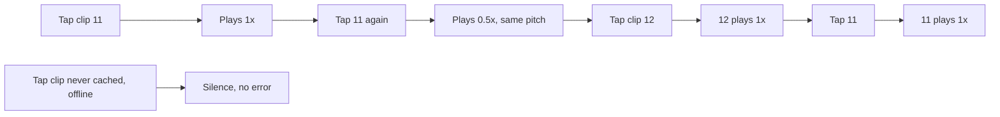
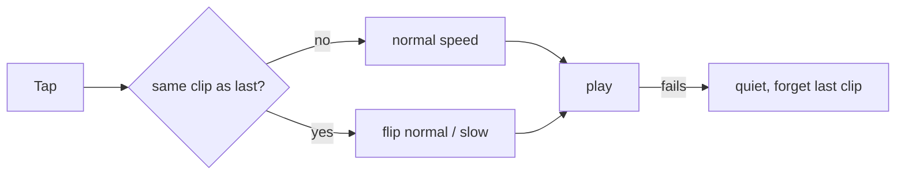
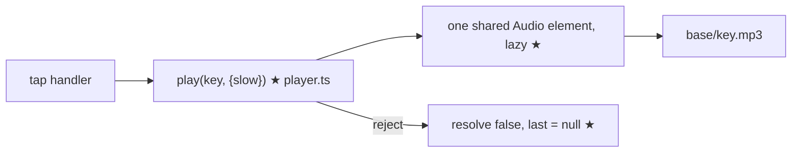

# CHY-16 S1 — picture

## What this slice is about
A learner taps a clip and hears it; tapping the same clip again plays it at half speed with the pitch kept. A failed clip stays silent and never errors.

| repo | ACs | lands | does not land |
|---|---|---|---|
| stonghuuloc/chaiyo | AC1, AC2, AC4 | `src/lib/audio/player.ts` + test + barrel | offline cache, /dev/audio, iOS device proof (S2) |

## AC1 — verbatim
> **AC1** Scenario: Tapping the same clip alternates normal and slow

## AC2 — verbatim
> **AC2** Scenario: A different clip starts at normal speed

## AC4 — verbatim
> **AC4** Scenario: An uncached clip offline fails quietly

## Expected result [AC1]

## Requirement [AC1]

## Solution [AC1] (new = ★)

## Plan
| task | AC | file:line | test |
|---|---|---|---|
| 1 tests first | [AC1] | src/lib/audio/player.test.ts | vitest --project server |
| 2 createPlayer | [AC2] | src/lib/audio/player.ts | same |
| 3 barrel | [AC4] | src/lib/audio/index.ts | pnpm check, lint, coverage |
| 4 browser proof | [AC1] | scratch page, not committed | Playwright, offline |

## Settled
| decision | source |
|---|---|
| `slow` omitted toggles, boolean forces | DISCUSSION D1 |
| failed play resets toggle | DISCUSSION D2 |
| base URL injected, default /audio | DISCUSSION D3 |
| defaultPlaybackRate set with playbackRate | advisor r1 #1 |

Carried elsewhere: offline cache and iOS device → S2; playing state → CHY-18.
