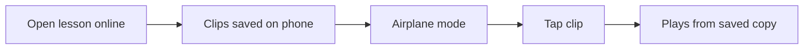
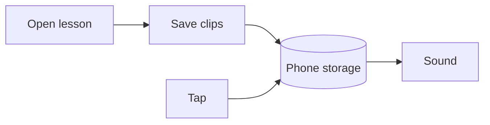
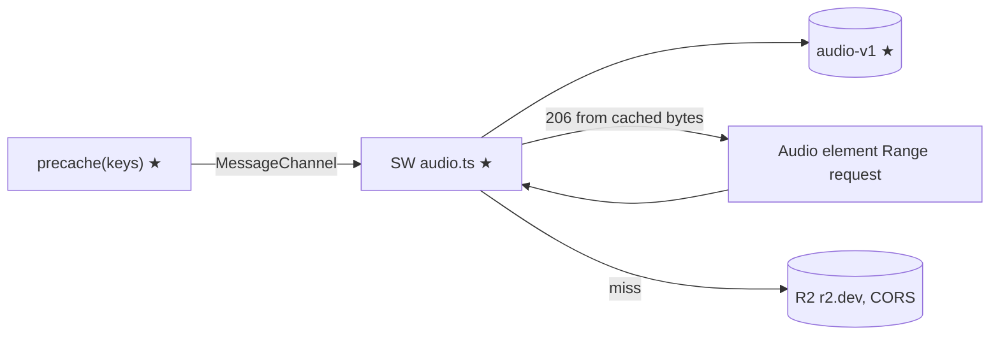

# CHY-16 S2 — picture

## What this slice is about
Opening a lesson stores its clips in the phone; in airplane mode they still play, including on iOS Safari. A dev-only page proves it.

| repo | ACs | lands | does not land |
|---|---|---|---|
| stonghuuloc/chaiyo | AC3, AC5 | `service-worker/audio.ts`, `precache`, `/dev/audio` | real lesson steps (M-5), bundle `audioKey` (CHY-8 follow-up) |

## AC3 — verbatim
> **AC3** Scenario: Opened lessons play offline

## AC5 — verbatim
> **AC5** Scenario: Works on iOS Safari after the first gesture

## Expected result [AC3]

## Requirement [AC3]

## Solution [AC3] (new = ★)

## Plan
| task | AC | file:line | test |
|---|---|---|---|
| 1 worker audio module | [AC3] | src/service-worker/audio.ts | vitest |
| 2 wire worker | [AC3] | src/service-worker/index.ts:17-27 | pnpm check |
| 3 precache + env | [AC3] | src/lib/audio/precache.ts, src/env.ts:13 | vitest |
| 4 /dev/audio | [AC5] | src/routes/dev/audio/ | screenshot |
| 5-6 proofs | [AC5] | offline browser, device | Playwright, Loc |

## Settled
| decision | source |
|---|---|
| precache by message, runtime cache too | DISCUSSION D1 |
| SW fetches whole clip, builds 206 itself | D2 |
| cache name audio-v1 survives deploys | D3 |
| /dev/audio 404 in production, https preview for the phone | D4, advisor #11 |

Carried elsewhere: AC5 needs a real iPhone or simulator (Loc); `audioKey` in the bundle → CHY-8 follow-up.
